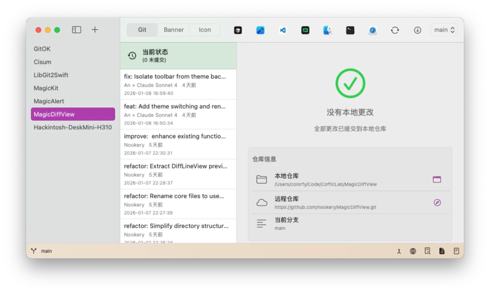

# GitOK

[](https://coffic.cn)
[](https://github.com/nookery)


📖 [中文版](README-zh.md) | [English](README.md)

## What

GitOK 是一个综合性的项目管理工具。

## 截图



## 下载

<https://github.com/CofficLab/GitOK/releases>

## 命令行

在 GitOK 中打开当前目录 —— 该目录会被加入项目列表并成为当前项目：

```sh
gitok .
```

`gitok <路径>` 可以打开任意目录。GitOK 注册了 `gitok://` URL scheme，
CLI 脚本只需把路径交给 Launch Services 即可。

### 安装

打开 **设置 → 通用 → 命令行工具**，点击「安装」。GitOK 会把 `gitok` 命令
写入一个**已经在你 PATH 中**的目录（因此不需要管理员密码），并显示安装位置。
点击「卸载」即可移除。

设置 `GITOK_APP` 可以指定打开哪一个构建版本（例如调试版与正式版同时运行时）：

```sh
GITOK_APP=/path/to/GitOK.app gitok .
```

## Why

有很多方式来保证工作流程简洁、高效、规范，比如：

- 约束性的文档
- 规范代码格式的脚本

为什么不用一个人性化的 APP 来做这些事呢？

我们需要一个工具来提高工作效率，希望它有这样的功能：

- 管理多个项目
- 创建一个项目，背后的工作包括但不限于：
  - 用脚手架创建项目文件夹
  - 初始化 Git 仓库及远程仓库
  - 准备好 CI/CD 脚本
- 辅助人类提交良好格式的 `commit message`
- 快速生成 APP 的多个平台的图标

## 本地化

界面文案存放在各 package 的 String Catalog：`Packages/<Package>/Resources/Localizable.xcstrings`，需覆盖 `en`、`zh-Hans`、`zh-Hant`、`zh-HK`、`zh-TW` 五种语言。调用时使用 `pluginLocalization.string(...)`（应用 target 使用 `GitOKAppLocalization`），不要直接写裸 `Text("...")` 字面量。

本地运行 `python3 Scripts/check_localization.py` 校验；`Localization` GitHub workflow 会在每个 PR 以及推送到 `dev` / `pre` / `main` 时自动执行。检查项包括 catalog JSON、五语言完整性、stale/孤儿 key、运行时格式串标注与裸 UI 字面量。详见 [.agent/rules/plugin-i18n-rules.md](.agent/rules/plugin-i18n-rules.md)。

## Our Other Projects

* [Cisum](https://github.com/CofficLab/Cisum_SwiftUI) - Apple 平台音频播放器
* [Lumi](https://github.com/CofficLab/Lumi) - AI 驱动的 macOS 个人桌面助手

## References

- [git commit emoji 使用指南](https://github.com/liuchengxu/git-commit-emoji-cn)
