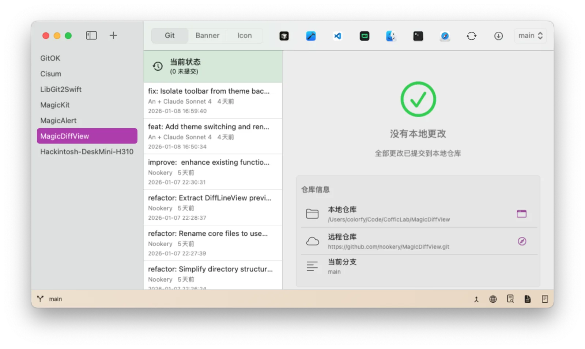

# GitOK

[](https://coffic.cn)
[](https://github.com/nookery)


📖 [中文版](README-zh.md) | [English](README.md)

## What

GitOK is a comprehensive project management tool.

## Screenshot



## Download

<https://github.com/CofficLab/GitOK/releases>

## Command Line

Open the current directory in GitOK — it is added to the project list and
becomes the current project:

```sh
gitok .
```

`gitok <path>` opens any directory. GitOK registers the `gitok://` URL scheme,
so the CLI script simply hands the path to Launch Services.

### Install

Open **Settings → General → Command Line Tool** and click **Install**. GitOK
writes the `gitok` command to a directory that is already on your `PATH`
(so no administrator password is needed), and reports where it was installed.
Use **Uninstall** to remove it again.

Set `GITOK_APP` to target a specific build (useful when a debug build is
running alongside the installed app):

```sh
GITOK_APP=/path/to/GitOK.app gitok .
```

## Why

There are many ways to ensure a clean, efficient, and standardized workflow, such as:

- Enforcing documentation
- Scripts to format code

Why not use a user-friendly app to do these things?

We need a tool to improve our work efficiency, and we'd like it to have the following features:

- Manage multiple projects
- When creating a project, the behind-the-scenes work includes but is not limited to:
  - Scaffolding project folders
  - Initializing Git repositories and remote repositories
  - Preparing CI/CD scripts
- Assisting users in writing well-formatted `commit messages`
- Quickly generating app icons for multiple platforms

## Localization

UI strings live in per-package String Catalogs at `Packages/<Package>/Resources/Localizable.xcstrings`, with `en`, `zh-Hans`, `zh-Hant`, `zh-HK`, and `zh-TW` translations. Resolve them through `pluginLocalization.string(...)` (or `GitOKAppLocalization` in the app), never through bare `Text("...")` literals.

Run `python3 Scripts/check_localization.py` locally. The `Localization` GitHub workflow runs it on every pull request and on pushes to `dev` / `pre` / `main`. It validates catalog JSON, the five-language coverage, stale/orphan keys, runtime-assembled format strings, and bare UI literals. See [.agent/rules/plugin-i18n-rules.md](.agent/rules/plugin-i18n-rules.md) for details.

## Our Other Projects

* [Cisum](https://github.com/CofficLab/Cisum_SwiftUI) - A player for Apple platform
* [Lumi](https://github.com/CofficLab/Lumi) - AI-powered personal desktop assistant for macOS

## References

- [git commit emoji usage guide (in Chinese)](https://github.com/liuchengxu/git-commit-emoji-cn)
